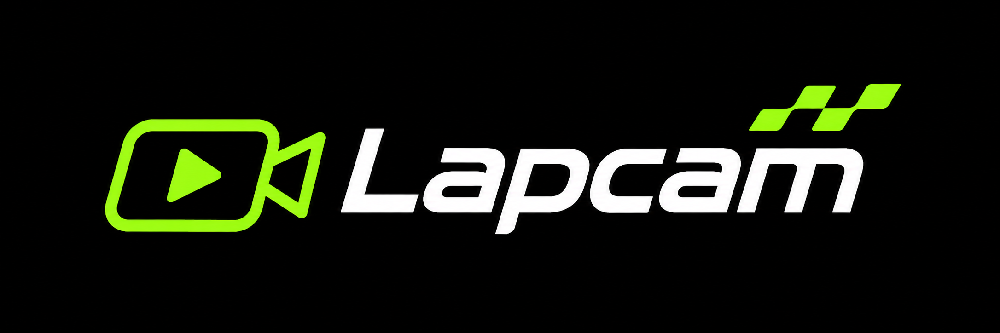
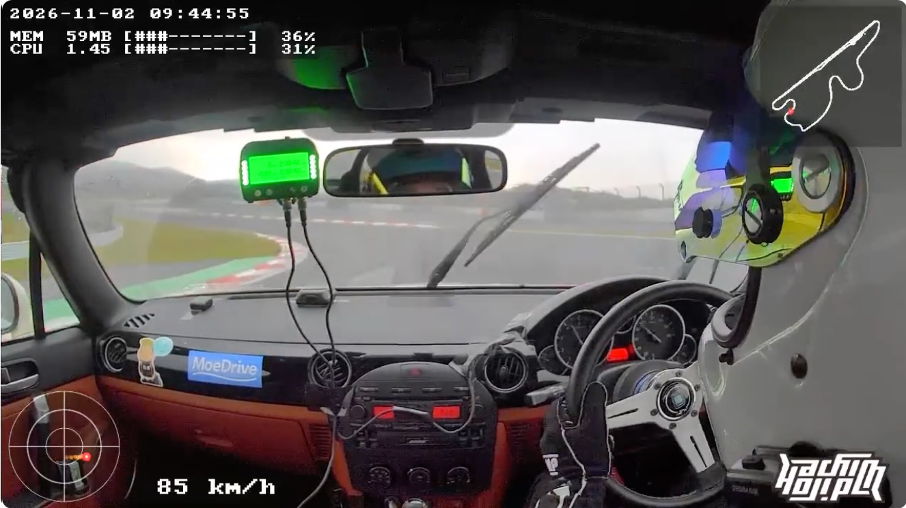
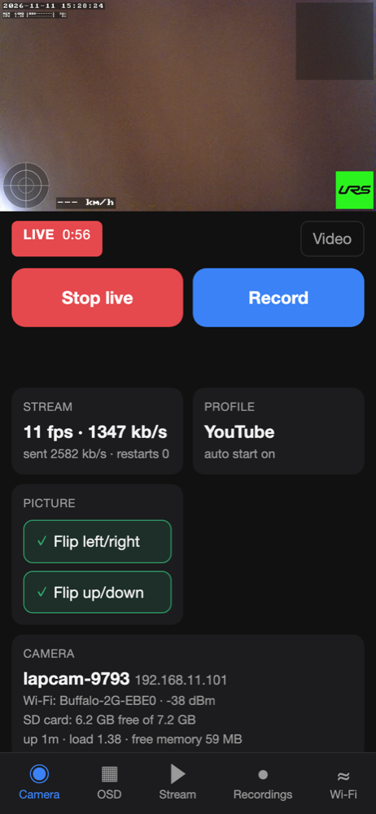
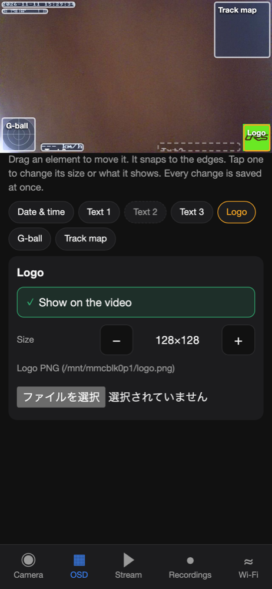
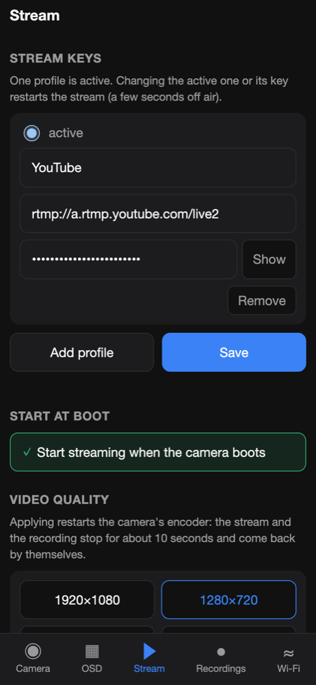
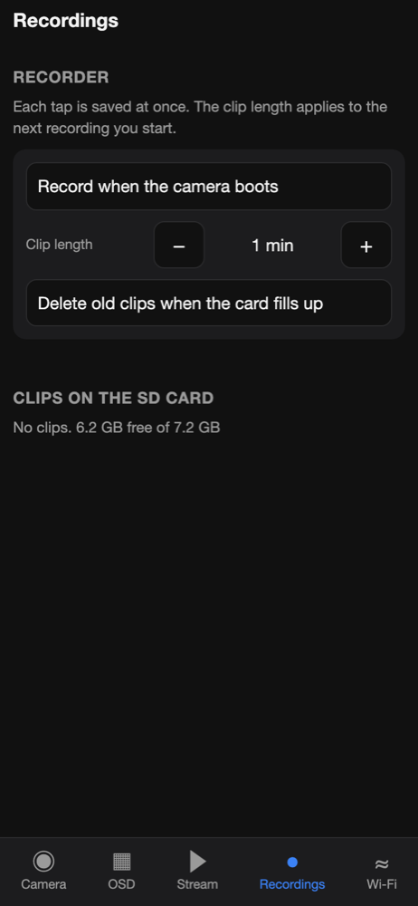

<p align="center"></p>

<p align="center">
<b>Wyze Cam v3 をレース用のオンボードカメラにするファームウェア</b><br>
YouTube Live へ直接配信 · SD カードに同時録画 · ロゴやテレメトリの OSD · スマホから操作
</p>

<p align="center">
<a href="https://github.com/uzulla/lapcam/releases/latest"></a>
<a href="LICENSE"></a>


</p>

<p align="center">
<a href="docs/getting-started.md"><b>はじめる</b></a> ·
<a href="https://github.com/uzulla/lapcam/releases">ダウンロード</a> ·
<a href="#ドキュメント">ドキュメント</a>
</p>

---

lapcam は、数千円の Wi-Fi カメラ **Wyze Cam v3** を、サーキット走行の車載カメラとして使うためのファームウェアと道具一式です。
SD カードを挿して電源を入れるだけでインストールでき、以後はカメラの電源を入れると勝手に配信が始まります。
中継用の PC やスマホアプリは要りません。

- **カメラから YouTube Live へ直接配信。** カメラが作った H.264/AAC をそのまま RTMPS で送るので、再エンコードも中継 PC も不要。
  テザリングやモバイルルーターの細い回線を想定し、送信量を映像の約 1.08 倍まで削り、電波が切れても戻れば自動で復帰します。
- **SD カードに同時録画。** 配信と同じ映像 (OSD 込み) を 1 分ごとの MP4 で保存。本体ボタンのダブルクリックでも開始・停止でき、録画中は正面の赤 LED が点きます。
- **OSD。** 時計、テキスト、チームのロゴ、[RaceBox](https://www.racebox.pro/) の G ボール・速度・走行図を映像に重ねられます。配置はスマホの画面上でドラッグするだけ。
  RaceBox のデータは、BLE を Wi-Fi に変換する [esp32-racebox-bridge](https://github.com/uzulla/esp32-racebox-bridge) (ESP32 の小さな基板) 経由で受け取ります。
- **スマホの Web UI。** プレビューを見ながら配信と録画の開始・停止、画質、ストリームキー、OSD、Wi-Fi、パスワードを 1 画面で。Thingino の Web UI を置き換えます。
- **設定は全部 SD カードに。** Wi-Fi、ストリームキー、SSH の鍵、OSD、ロゴ、録画がカードの上にあるので、カードを差し替えれば別の現場の設定になり、ファームウェアを更新しても設定は残ります (パスワードだけはカメラ側で、焼き直すと初期値に戻ります)。
- **現地で困らない。** ボタンを 5 秒押せばカメラ自身が Wi-Fi を出して設定画面を開けます。名前は `lapcam-xxxx.local`、LAN には自分の IP と状態を放送し続けます。

<p align="center"></p>
<p align="center"><sub>実際の配信から (2026-11-02)。時計、G ボール、速度、走行図、ロゴはすべてカメラの中で重ねている</sub></p>

<p align="center">




</p>

> **English**: lapcam turns a Wyze Cam v3 into an onboard camera for track days. It is a custom
> [Thingino](https://thingino.com/)-based firmware that streams straight to YouTube Live over RTMPS
> (stream copy, no relay PC), records the same video to the SD card, overlays a logo and RaceBox telemetry,
> and is operated from a phone. Install by inserting the SD card and powering on. Docs are in Japanese;
> the card's `README.txt` and the Web UI are in English.

## しくみ

```text
従来:  Wyze Cam v3 ──RTSP──▶ 中継 PC (ffmpeg) ──RTMPS──▶ YouTube Live
lapcam: Wyze Cam v3 ─────────────────────────RTMPS──▶ YouTube Live
```

Thingino (オープンな IP カメラ用ファームウェア) を土台に、配信の監視、OSD、録画、ボタン、ホスト名などを焼き込んだ自前のイメージを作っています。
フラッシュに入りきらないプログラム (Web UI の `lapcam`、OSD を描く `osd-feed`、状態を放送する `beacon`、`ffmpeg`) と設定は SD カードに置き、
起動時にカードから読みます。カメラの中でやっていることは `prudynt` (Thingino のストリーマ) が出す H.264/AAC を `ffmpeg` が FLV に詰めて
TLS で送るだけで、CPU の負荷は配信で数 % です。

## はじめる

必要なものは Wyze Cam v3 と FAT32 の microSD カード、2.4 GHz の Wi-Fi、スマホ。
[Releases](https://github.com/uzulla/lapcam/releases) の zip をカードに展開し、Wi-Fi の設定を書いて、カメラに挿して電源を入れます。
手順は **[docs/getting-started.md](docs/getting-started.md)** に。

## ドキュメント

| 使う | |
|---|---|
| [はじめる](docs/getting-started.md) | カードを作ってカメラに入れる、最初の設定、更新 |
| [Web UI (lapcam)](docs/lapcam.md) | 各タブでできること、AP モード、仕組み |
| [カメラを探す](docs/find-camera.md) | `lapcam-xxxx.local`、`tools/find-camera`、ルーターの一覧 |
| [トラブルシュート](docs/troubleshooting.md) | 症状別の対処、ログの読み方 |

| 機能ごと | |
|---|---|
| [配信](docs/relay.md) | 配信の監視 (`youtube-relay`) と設定ファイル |
| [録画](docs/recording.md) | SD 録画の仕組み、ファイルの取り出しと結合 |
| [OSD](docs/osd.md) / [osd-feed](docs/osd-feed.md) | テキスト・画像 OSD の仕様、テンプレート、RaceBox のテレメトリ |
| [beacon](docs/beacon.md) | 状態の UDP 放送と、PC からの指令 |
| [SD カードの Wi-Fi 設定](docs/wifi-from-sd.md) | `wpa_supplicant.conf` の書き方 |
| [セルラー回線](docs/cellular.md) | 送信量と切断からの復帰の実測 |
| [本体ボタン](docs/setup-button.md) / [LED](docs/front-led.md) / [スピーカー](docs/speaker.md) | ハードウェアの小ネタ |

| 作る | |
|---|---|
| [SD カードとファームウェア](docs/sdcard.md) | インストールの仕組み、`firmware/` のスクリプト、カードの中身、焼いた後に残るもの |
| [開発](docs/development.md) | リポジトリの構成、対応するカメラとファームウェア、ビルドとテスト |
| [ビルド手順](docs/build.md) | ファームウェアイメージと ffmpeg / prudynt のビルド |
| [バージョンとリリース](docs/release.md) | 版の付け方、`tools/release.sh` |
| [NOTES.md](NOTES.md) | 設計の判断、ハマりどころ、実測値の記録 |

## ライセンス

自作部分は [MIT](LICENSE)。FFmpeg 由来のパッチとバイナリは GPL-3.0-or-later、その他の第三者由来のものは [LICENSE.md](LICENSE.md) に。

## 謝辞

- [Thingino](https://github.com/themactep/thingino-firmware): オープンな IP カメラファームウェアと、そのビルド環境
- [thingino-installers](https://github.com/wltechblog/thingino-installers): 純正の Wyze Cam v3 に SD カードから書き込む仕組み
- [FFmpeg](https://ffmpeg.org/)

---

<p align="center"><sub>lapcam は <b>URS (uzulla racing support)</b> が開発しています。</sub></p>
