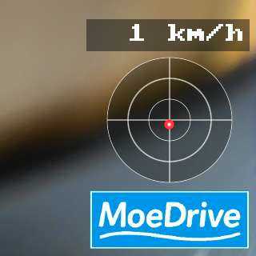
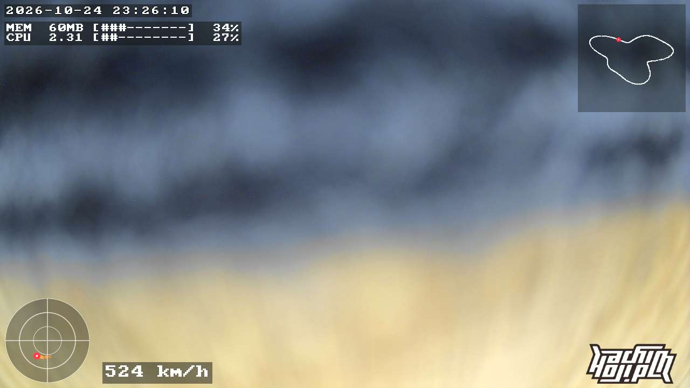

# osd-feed: OSD テキストを自動更新する常駐プログラム

[OSD テキストオーバーレイ](osd.md) の矩形に出す文字列を、カメラ上の常駐プログラム `osd-feed` が
**データ源 (source) → テンプレート → ファイル** の流れで書き続ける。まずはメモリの空き量、0→100% をループする
バー、時刻のサンプル。外部のデータ (HTTP で JSON を取る) も同じ仕組みで足せる。

```
osd-feed (Go、SD カードから実行)
  sources ─ それぞれ自分の間隔で取得して最新値を持つ ─┐
    meminfo  /proc/meminfo                               │
    cpu      /proc/stat, /proc/loadavg                   │  250ms ごとに描く
    tick     0→100 をループするカウンタ                  ├─▶ スロットごとの text/template
    clock    時刻                                        │      → cols×rows に切る → ASCII 以外を ? に
    http     URL を GET して JSON をそのまま値に          │      → 前回と違う時だけ tmp + mv で書く
    udp      送られてくる JSON (RaceBox など) の最新値    ┘
  imagefile ─ SD の透過 PNG → 生 BGRA (width×height) ──────▶ 画像スロットのファイル (PNG が変わった時だけ)
              + G ボール (udp の G から。玉が動いた時だけ) ─┘
```

- **言語は Go**。カメラにはインタプリタが無く、Mac で `go build` したバイナリ (静的、libc 非依存) がそのまま動く。
  外部データに必要な HTTP / JSON / タイムアウト / 並行取得が標準ライブラリで済むのが選んだ理由
- **バイナリ (約 8MB) と設定は SD カードに置く** (`/mnt/mmcblk0p1/osd-feed`、`osd-feed.json`)。内蔵フラッシュの
  overlay (空き 6MB 程度) には入らない。overlay に置くのは起動スクリプト `S94osd-feed` だけで、SD に両方あれば起動、
  無ければ何もしない
- 実測 (720p 配信中の Wyze Cam v3): 4 Hz 更新で CPU 0.8%、RSS 8MB で頭打ち (下の「計測」)
- prudynt との約束は [osd.md](osd.md) のとおり: tmpfs 上に一時ファイルを書いて `mv`。**フラッシュには何も書かない**
- 矩形の**有効化・位置・大きさは osd-feed の仕事ではない**。従来どおり SD の `prudynt-osd.json` か
  [Web UI](osd.md#web-ui-から編集する) で行う (有効になっていないスロットに書いても映らない。起動時のログに出る)
- Web UI の Show / Clear と同じファイルを書くので、osd-feed が動いている間は Show は使わない (次の描画で上書きされる。
  Clear で消した場合も、ファイルが無いのに気づいて書き直す)
- **SD カードは動作中に抜かない前提** (バイナリを SD から直接実行している。抜くとプロセスが異常終了し、終了時の
  ファイル削除も走らないので、最後の表示が残る)

## インストール

```sh
device/osd-feed/build.sh                          # Mac/PC で。Go 1.25 以降。dist/osd-feed ができる
device/install-osd-feed.sh root@<camera-ip>       # SD にバイナリと (無ければ) 設定例、overlay に S94osd-feed を置いて起動
```

- 手で置くなら: `dist/osd-feed` → SD の `osd-feed` (実行属性は exFAT なので不要)、`device/osd-feed/osd-feed.json.example` →
  SD の `osd-feed.json`、`device/S94osd-feed` → `/etc/init.d/S94osd-feed` (chmod +x)
- 起動・停止: `service start osd-feed` / `service stop osd-feed` / `service disable osd-feed`。ログは `logread | grep osd-feed`
- 設定を変えたら `service restart osd-feed`。先に `/mnt/mmcblk0p1/osd-feed -once` を実行すると、各スロットの描画結果を
  標準出力に 1 回出して終わるので、テンプレートの確認に使える。`udp` の source は最初の 1 件が届くまで `timeout_ms` (既定 3 秒) 待つ
- 消す: `service stop osd-feed; rm /etc/init.d/S94osd-feed /mnt/mmcblk0p1/osd-feed /mnt/mmcblk0p1/osd-feed.json`。
  終了時に書いていたファイル (`/run/prudynt/osd-text*`) は消す (`clear_on_exit`)

## 設定 (`osd-feed.json`)

```json
{
  "interval_ms": 250,
  "sources": {
    "mem":   { "type": "meminfo", "interval_ms": 1000 },
    "tick":  { "type": "tick",    "interval_ms": 100 },
    "clock": { "type": "clock",   "interval_ms": 1000 }
  },
  "slots": {
    "textfile": {
      "template": "MEM {{lpad 3 .mem.free_mb}}MB free  {{lpad 3 .mem.used_pct}}% used\n{{bar 30 .tick.pct}} {{lpad 3 .tick.pct}}%\n{{.clock.date}} {{.clock.hms}}"
    },
    "textfile2": { "template": "{{.clock.hms}}" }
  }
}
```

| キー | 意味 |
|---|---|
| `interval_ms` | 描く間隔 (既定 250、下限 100)。prudynt 側がファイルを見るのは 100ms ごとなので、それより短くしても速くならない |
| `clear_on_exit` | 終了時にスロットのファイルを消す (既定 true) |
| `sources.<名前>` | データ源。`type` と `interval_ms` (取得間隔、既定 1000)、type ごとの項目 (下表)。名前はテンプレートから `.<名前>.<キー>` で参照する |
| `slots.imagefile` / `slots.imagefile2` / `slots.imagefile3` | 画像スロット ([osd.md](osd.md#画像-ロゴなど-を重ねる-osdimagefile))。3 枚は別々に置ける (ロゴ、G ボール、走行図など)。`png` (SD カード上の透過 PNG)、`fit` (`contain` = 縮めて収める・拡大はしない・中央配置、`none` = そのまま中央に置き、はみ出た分は切る。既定 `contain`)、`png_box` (PNG を置く場所 `{"x","y","width","height"}`。既定はスロット全体)、`gball` ([G ボール](#racebox-の-g-ボールと速度))、`track` ([走行図](#racebox-の-gps-から走行図))。`png`、`gball`、`track` の少なくとも 1 つが要る。`width` / `height` / `path` は普通は書かない (prudynt から読む) |
| `slots.<スロット>` | `textfile` / `textfile2` / `textfile3`。`template` は Go の text/template。`path` / `cols` / `rows` は普通は書かない: 起動時と以後 30 秒ごとに prudynt から読んで追従する (Web UI で大きさを変えれば 30 秒以内に切る幅も変わる。prudynt が答えない時は docs/osd.md の既定値)。**ここに書いた値は prudynt の値より常に優先される**ので、Web UI で変えたのに反映されない時はここに古い値が残っていないか見る |

### source の種類

| `type` | 出す値 | 追加の設定 |
|---|---|---|
| `meminfo` | `free_kb` `free_mb` `total_mb` `used_pct` (buffers/cache は空きに数える。`free` コマンドと同じ) | — |
| `cpu` | `used_pct` (前回の取得からの CPU 使用率。`/proc/stat` の `cpu` 行、iowait は空きに数える。起動直後の 1 回目は起動からの平均) `load1` `load5` `load15` (`/proc/loadavg` の文字列そのまま、例 `0.52`) | — |
| `tick` | `n` (0→max をループ) `pct` (n の百分率) `max` | `step` (1 回の増分、既定 1)、`max` (既定 100)。`interval_ms` 100 で 10 秒で 1 周 |
| `clock` | `hms` `date` `unix` (カメラのローカル時刻。`/etc/TZ` の POSIX 形式を読む。DST の規則は無視) | — |
| `udp` | 受け取った JSON オブジェクトのメンバーがキー (入れ子は `http` と同じく `_` でつなぐ。`{"g":{"x":0.1}}` → `.rb.g_x`)。**数値は文字のまま持つ** (`json.Number`。表示する分だけ使う時に変換する)。配列は値を使わない (形が壊れていれば、その 1 件は捨てる)。最後に届いた 1 件を取得のたびに読むので、1 秒に 25 件届いても解析は `interval_ms` ごとの 1 件だけ。`stale_ms` の間 `match` に合うものが届かなければ取得失敗 (`ok` が false、値は残る) | `listen` (必須、例 `":5005"`。起動時に bind し、使えなければ起動しない)、`match` (`{"type":"racebox"}` のように、トップレベルの文字列メンバーがこの値のものだけ使う)、`stale_ms` (既定 1000)。`interval_ms` の既定は 100 (他の source の 1000 では玉が 1 秒ごとにしか動かない) |
| `http` | GET した JSON オブジェクトのメンバーがキー。**入れ子のオブジェクトは `_` でつないで平らにする** (`{"gps":{"lat":35.6}}` → `.car.gps_lat`。取得前や欠けている時に空文字で済ませるため)。メンバーの値が配列ならそのまま (`{{index .car.list 0}}`)。平坦化後に同じキーになるメンバーがあれば取得エラー。本文が JSON オブジェクトでなければ (配列・数値・文字列・`null`・JSON 以外) `body` (文字列)。`status` は常に HTTP ステータス (同名の JSON メンバーは見えない) | `url` (必須)、`timeout_ms` (既定 3000)、`headers` (`{"Authorization": "..."}`) |

どの source にも **`ok`** (直前の取得が成功した) と **`age_s`** (最後に成功してからの秒数。一度も無ければ -1) が付く。
取得に失敗しても前回の値は残るので、外部データが途切れた時の見せ方はテンプレート側で決める:
`{{if .car.ok}}{{.car.speed}} km/h{{else}}-- km/h{{end}}`。失敗は種類が変わった時と復帰した時だけログに出る
(ファイルの書き込みエラーも同じ)。取得が `timeout_ms` を超えると打ち切られ、その間も他の source と描画は止まらない。

### テンプレートで使える関数

text/template 標準の `printf` `if` `range` などに加えて:

| 関数 | 例 | 結果 |
|---|---|---|
| `bar 幅 値` | `{{bar 30 .tick.pct}}` | `[#########---------------------]` (幅 30、値は 0〜100) |
| `lpad 桁 値` | `{{lpad 5 .mem.free_mb}}` | 右寄せ `   67` |
| `rpad 桁 値` | `{{rpad 8 .clock.hms}}` | 左寄せ |
| `trunc 桁 値` | `{{trunc 10 .car.name}}` | 先頭 10 文字 |
| `mul 値 値` | `{{printf "%3.0f" (mul .rb.speed_mps 3.6)}}` | 掛け算 (小数)。m/s → km/h など。`printf` で桁を決める |

- 行数・桁数を超えた分は切る (prudynt も切るが、こちらで切っておくと何が映るか手元で分かる)。タブは空白、ASCII 以外は `?`
- source がまだ値を持っていないキーは空文字になる (`lpad` などの関数に渡しても同じ。`bar` は 0)。**設定に無い source をテンプレートが参照していると起動時にエラーで止まる** (綴り間違いをその場で見つけるため)
- `http` の JSON の数値は小数として入る (`{{printf "%.0f" .car.speed}}` で整数表示)。`bar` はそのまま受け付ける

### 画像 (ロゴ) を出す

```json
"imagefile": { "png": "/mnt/mmcblk0p1/logo.png", "fit": "contain" }
```

- PNG は Go の `image/png` でデコードし、prudynt の `osd.imagefile` の `width × height` に収めて (アスペクト比を保って縮小、
  拡大はしない、余白は透明、中央配置)、**ヘッダなしの生 BGRA (ストレートアルファ)** に変換して `mv` で置く。透過 PNG の
  アルファはそのまま映像に合成される
- 変換は起動時と、PNG の mtime / サイズが変わった時、スロットの大きさが変わった時 (Web UI で変えると 30 秒以内に追従)。
  1280 × 720 でも起動時 1 回なので softfloat の MIPS でも問題ない
- PNG が読めない (無い、壊れている、大きすぎる: 1 辺 4096 px 超、または 8-bit で約 184 万画素 (16-bit はその半分) 超) 時は
  ファイルを消して非表示にし、ログに 1 回出す。壊れた PNG が置かれたままでも再デコードはしない (同じ中身なら結果を覚えている)。直れば戻る
- 大きい画像は OSD プールが要る (`prudynt-osd.json` の `general.osd_pool_size`。1280 × 720 なら 8192)
- 実測 (720p 配信中、400×400 の PNG、テキスト 3 枚と同時):

  | 状況 | osd-feed の CPU | RSS |
  |---|---|---|
  | 200×200、変化なし | 0.8% | 6.5MB |
  | 1280×720、変化なし | 0.9% | 11.6MB |
  | 1280×720、PNG を毎秒 touch (中身は同じ) | 0.9% | 〃 |
  | 1280×720、PNG の**中身**が毎秒変わる (毎秒デコード + 変換) | 10% | 〃 |

  待機中は PNG とスロットのファイルを stat するだけなので大きさに依らず軽い。毎秒デコードするような使い方 (グラフ等)
  は 200×200 程度の大きさにするか、PNG を経由せず直接 BGRA を描く (将来の拡張) 方が向く

### RaceBox の G ボールと速度

[esp32-racebox](https://github.com/uzulla/esp32-racebox) (RaceBox Mini → ESP32 → Wi-Fi の UDP ブロードキャスト、
1 件 1 JSON、最大 25 件/秒) の G を 2 枚目の画像スロット (`imagefile2`) に **G ボール**として描き、速度をテキストで出す。ロゴ (`imagefile`) とは別の
スロットなので、位置は Web UI の OSD Settings の **G-ball** カードで別々に動かせる。カメラと ESP32 が同じ
LAN (同じブロードキャストドメイン) にあること。

```json
{
  "interval_ms": 100,
  "sources": {
    "racebox": { "type": "udp", "listen": ":5005", "match": { "type": "racebox" }, "stale_ms": 500 }
  },
  "slots": {
    "imagefile": { "png": "/mnt/mmcblk0p1/logo.png" },
    "imagefile2": { "gball": { "source": "racebox", "invert_lateral": true } },
    "textfile3": {
      "template": "{{if .racebox.ok}}{{printf \"%3.0f\" (mul .racebox.speed_mps 3.6)}}{{else}}---{{end}} km/h"
    }
  }
}
```

`prudynt-osd.json` (SD) 側は、ロゴを右下に、G ボールをその上に、`textfile3` (速度) をさらに上に置く:

```json
"imagefile": { "enabled": true, "width": 200, "height": 74, "pos_x": -8, "pos_y": -8 },
"imagefile2": { "enabled": true, "width": 160, "height": 160, "pos_x": -28, "pos_y": -90 },
"textfile3": { "enabled": true, "cols": 8, "rows": 1, "scale": 3, "pos_x": -8, "pos_y": -256 }
```

1 枚の画像スロットにロゴと G ボールを両方描くこともできる (`png_box` で PNG の場所を決め、`gball` の `x` / `y` / `size`
で G ボールの場所を決める) が、その場合は 2 つが一緒にしか動かない。



- **G ボール** (`gball`): 0.5G ごとの輪 (1G は太め) と十字、半透明の円を下絵として 1 回だけ描き、玉 (赤) と軌跡
  (橙、直近の描画 `trail` 回分) を重ねる。玉は「お椀の中の玉」の向き: ブレーキで上、加速で下、右旋回で左。外周を超える G は
  外周に貼り付く
  | キー | 既定値 | 意味 |
  |---|---|---|
  | `source` | (必須) | 値を取る source |
  | `lateral` / `longitudinal` | `g_y` / `g_x` | 横 G (右が +) と前後 G (加速が +) のキー。既定は esp32-racebox (RaceBox は X が前後、Y が左右) |
  | `invert_lateral` / `invert_longitudinal` | false | 向きを反転。RaceBox の文書は軸の正の向きを書いていない。**RaceBox を傾けて、玉が低い側へ転がるように合わせる** (手元の RaceBox Mini は映像で左右が逆だったので `invert_lateral: true` にしている) |
  | `max_g` | 1.5 | 外周の G (10 まで) |
  | `trail` | 8 | 軌跡の点の数 (0 で無し) |
  | `x` / `y` / `size` | 0 / 0 / 収まる最大 | スロット内の位置と一辺 (px、`size` は 32〜720) |
- **データが来ない間** (`stale_ms` の間 `match` に合う JSON が届かない、値が数値でない) は玉と軌跡を消し、輪だけ残す。
  戻った時に古い軌跡を引きずらない
- **速度はテキスト** (`textfile3`)。esp32-racebox の `speed_mps` は GPS の速度なので、止まっていても 1〜2 km/h 出ることがある
- 負荷 (720p 配信中、RaceBox から 25 件/秒、上の設定): osd-feed **2.65%**、prudynt 7.8% (G ボール無しの 7.25% から +0.5)。
  G ボール無しで同じ 100ms 描画なら osd-feed 1.1%。下げるために効いたこと:
  - 画像は玉と軌跡の周りだけ描き直す。スロット全体 (200×242、189KB) を毎回複製すると、それだけで osd-feed が 8% を超えた
  - JSON は自前の読み取り (`flatjson.go`)。Go の `encoding/json` はこのカメラで RaceBox 1 件 (約 600 バイト) に 3.4ms
    かかり (自前は 0.5ms)、1 秒 25 件をすべて読むと数 % になる。さらに読むのは取得のたびの最新 1 件だけ

### RaceBox の GPS から走行図

同じ esp32-racebox の緯度・経度を 3 枚目の画像スロット (`imagefile3`) に**走行図**として描く。地図は持たず、走った位置を
点で積み上げるだけ。一周 2〜3 分のサーキットなら、数周 (5〜10 分) 走ると軌跡だけでコースの形になる。古い点は
`points` 個を超えた分から消える (G ボールの軌跡と同じ考え方)。描く範囲は、残っている点の緯度・経度の最小〜最大 (北が上、
縦横同じ縮尺)。位置は Web UI の OSD Settings の **Track map** カードで動かせる。

osd-feed.json の `slots` に足す (source は G ボールと同じ `racebox`):

```json
"imagefile3": { "track": { "source": "racebox" } }
```

`prudynt-osd.json` (SD) 側:

```json
"imagefile3": { "enabled": true, "width": 200, "height": 200, "pos_x": 8, "pos_y": 40 }
```



白い点が走った跡、赤い点が今の位置。データが来ない間 (`stale_ms`) は赤い点だけ消し、走行図は残す。

| キー | 既定値 | 意味 |
|---|---|---|
| `source` | (必須) | 値を取る source |
| `lat` / `lon` | `lat` / `lon` | 緯度・経度 (度) のキー。既定は esp32-racebox |
| `valid` | `latlon_valid` | これが false の位置は描かない (GPS が測位できていない)。source にこのキーが無ければ全部描く |
| `points` | 6000 | 残す点の数 (36000 まで)。点は描き直しの間隔 (`interval_ms`) ごとに多くて 1 つなので、100ms なら 6000 点で最短 10 分 (下記) |
| `min_move_m` | 3 | 前の点からこれ (m) 未満しか動いていなければ点を足さない。ピットで止まっている間に `points` を使い切らないため (0 で毎回足す) |
| `x` / `y` / `width` / `height` | 0 / 0 / 残り全部 | スロット内の位置と大きさ (px、32 以上) |

- 描く範囲は、はみ出す点が来た時に余白 (幅の 10%) を付けて広げ、古い点が消えて範囲が十分小さくなったら縮める。
  範囲が変わった時だけ全部の点を描き直し、普段は増えた点と消えた点の画素だけ描き直す。範囲は最小でも 100m 四方
- 前の点から 20km 以上離れた位置が来たら (別のサーキットに移った)、それまでの点を捨てて描き直す
- 点は osd-feed のメモリにだけあるので、osd-feed の再起動や、スロットの大きさを変えた時は最初から描き直しになる
- **点を足す頻度**: 描き直し (`interval_ms`、上の例では 100ms) のたびに、その時いちばん新しい位置を 1 つ見る。RaceBox は
  最大 25 件/秒送ってくるが、間の位置は使わない。さらに前の点から `min_move_m` (3m) 未満なら足さないので、速度で変わる。
  100ms で 3m 進むのは時速 108km

  | 速度 | 点の間隔 | 1 秒あたり | 6000 点が残る時間 |
  |---|---|---|---|
  | 時速 150km | 毎回 (約 4.2m) | 10 点 | 10 分 |
  | 時速 100km | 2 回に 1 回 (約 5.6m) | 5 点 | 20 分 |
  | 時速 30km | 4 回に 1 回 (約 3.3m) | 2.5 点 | 40 分 |
  | 停車中 | 足さない | 0 点 | — |

- **点の数と重さ**:
  - 普段の描き直しは点の数に依らず一定 (新しい点を 1 つ描く、いちばん古い点を 1 つ消す、赤い点を動かす)。prudynt が読む
    ファイルもスロットの大きさで決まる (200×200 で 156KB) ので、点の数には関係ない
  - メモリは 1 点 12 バイト (6000 点で 72KB、36000 点で約 430KB) と、描く範囲の画素ごとに 2 バイト (200×200 で 80KB)
  - 点の数に比例するのは、全部の点を描き直す時だけ。起きるのは、車が描く範囲からはみ出した時 (余白を付けて広げるので、
    ほぼ 1 周目だけ) と、古い点が消えて範囲を縮められるようになった時。縮められるかどうかの判定 (100 点ごとに全部の点の
    最小・最大を取る) も点の数に比例するが、整数の比較だけなので軽い
  - 全部の描き直しにかかる時間は点の数を変えて測っていない。上限の 36000 点では、1 周目に数十ミリ秒の描き直しが
    時々起きる可能性がある (見込み)。普段の使い方なら既定の 6000 点で足りる
- 負荷 (720p 配信中、RaceBox 形式のダミーを 20 件/秒、上の G ボール・速度と同時、200×200): 走行図ありで osd-feed **4.5%**、prudynt 10.0%、
  走行図なしで osd-feed 3.4%、prudynt 9.1%。走行図の分は合わせて約 2%。osd-feed は増えた点と動いた赤い点の周りしか
  描き直さないが、赤い点が毎回動くので、スロットのファイル (156KB) は毎回書き直され、prudynt はそれを毎回読む

### 外部データを足す

`http` source を書き足すだけで、テンプレートから参照できる:

```json
"car": { "type": "http", "url": "http://192.168.11.5/status.json", "interval_ms": 2000, "timeout_ms": 1500 }
```

新しい種類の source (シリアル、MQTT、…) は `device/osd-feed/source.go` の `Source` インタフェース
(`Poll(ctx) (Values, error)`) を実装して `sourceTypes` に登録し、`build.sh` で作り直す。ループ内で浮動小数点の計算を多用しない
(MIPS 向けはソフトウェア浮動小数点でビルドしている)。

## 計測

720p 配信中の Wyze Cam v3 (load average 1.6、prudynt + ffmpeg が動いている状態) で、設定例 (250ms 描画、tick は 100ms、
スロット 2 つ) を 15 分 + 追跡 5 分:

| 項目 | 値 |
|---|---|
| CPU | **0.8%** (15 分で 7.3 秒。その後も 1 分あたり約 0.5 秒で一定) |
| RSS | 起動直後 4.6MB → 15 分で **8.0MB** で頭打ち (その後 5 分で +8KB)。Go の GC がヒープを 2 倍まで育ててから止まる分で、リークではない |
| 書き込み | tick が変わる 100ms ごとの描画のうち、内容が変わった時だけ (実質 4 回/秒) |
| バイナリ | 8.3MB (net/http、text/template 込み。SD カード上) |

比較: 同じ処理を busybox sh で書くと CPU 1.4% (fork 分を除く) / RSS 0.5MB、C なら CPU・RSS ともこの数分の 1 になる見込み。
このカメラで問題になる量ではないと判断して Go にした (経緯は ISSUE #35)。
