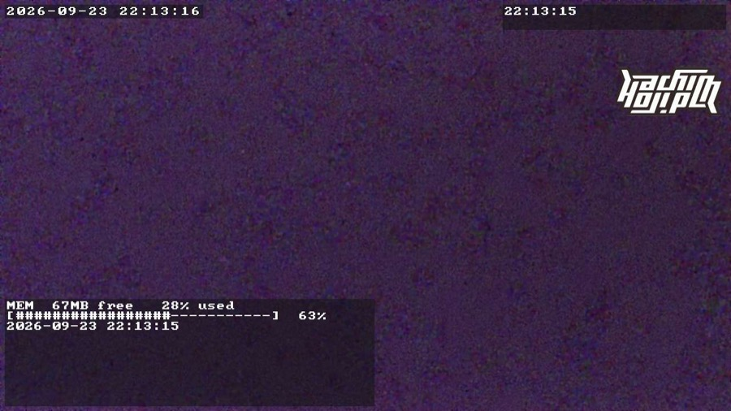

# OSD テキスト・画像オーバーレイ

配信 (と録画) の映像に、複数行テキストの矩形を **3 つ** と、ラスタ画像を **4 枚** 焼き込む prudynt のパッチ
(`patches/prudynt-osd-textfile.diff`) と、その設定を SD カードに置いて起動のたびに反映する常駐スクリプト `osd-config` の説明。
左上の日時は prudynt 標準 (`osd.burnin`)。lapcam のファームウェアにはパッチ入りの prudynt (フル ASCII の 8x8 フォント) と
`osd-config` が入っているので、入れるものは無い ([sdcard.md](sdcard.md))。

- **配置・大きさ・表示の有無**は lapcam の **OSD タブ** で変える ([lapcam.md](lapcam.md))。結果は SD カード直下の
  `prudynt-osd.json` に保存され、`osd-config` が起動のたびに送り直す ([下記](#設定を-sd-カードに置く-再起動しても消えないようにする))
- **表示する文字列と画像の中身**は常駐プログラム [osd-feed](osd-feed.md) が書く (テンプレートも OSD タブで編集する)
- この文書はその裏側: prudynt が読むファイルの契約、設定キー、OSD プールの上限、`osd-config` の動き。
  パッチ入り prudynt のビルドは [build.md](build.md)

## 使い方 (prudynt が読むファイルの契約)

```sh
# 1. 有効化 (実行中の prudynt にだけ反映。再起動で無効に戻る。常用は SD の prudynt-osd.json で: 下記)
prudyntctl json '{"osd":{"textfile":{"enabled":true}}}'

# 2. テキストを出す/書き換える: 一時ファイルに書いて mv で置き換える (0.1 秒以内に反映)
printf 'UPLOAD job-42\n[##########----------] 50%%\n' > /run/prudynt/osd-text.tmp \
  && mv /run/prudynt/osd-text.tmp /run/prudynt/osd-text

# 3. 消す: ファイルを消す (空にしても同じ)
rm /run/prudynt/osd-text

# 右上・右下も同じ。設定名とファイル名が違うだけ
prudyntctl json '{"osd":{"textfile2":{"enabled":true},"textfile3":{"enabled":true}}}'
echo 'REC' > /run/prudynt/osd-text2.tmp && mv /run/prudynt/osd-text2.tmp /run/prudynt/osd-text2
```

| 設定 | 既定の位置 | 既定のファイル | 既定の桁×行 |
|---|---|---|---|
| `osd.textfile` | 左下 (`pos_x` 8, `pos_y` -8) | `/run/prudynt/osd-text` | 40×4 |
| `osd.textfile2` | 右上 (-8, 8) | `/run/prudynt/osd-text2` | 24×2 |
| `osd.textfile3` | 右下 (-8, -8) | `/run/prudynt/osd-text3` | 24×2 |
| `osd.imagefile` (画像、[下記](#画像-ロゴなど-を重ねる-osdimagefile)) | 右上 (-8, 8) | `/run/prudynt/osd-image` | 200×200 px |
| `osd.imagefile2` (2 枚目の画像) | 右下、`textfile3` の上 (-8, -64) | `/run/prudynt/osd-image2` | 160×160 px |
| `osd.imagefile3` (3 枚目の画像) | 左上 (8, 40) | `/run/prudynt/osd-image3` | 200×200 px |
| `osd.imagefile4` (4 枚目の画像、リモートカメラ用) | 左上、テキストの下 (8, 80) | `/run/prudynt/osd-image4` | 320×240 px |

位置はどれも自由に変えられる (3 つの違いは既定値だけ)。矩形同士が重なった場合は番号の大きい方が手前。
上の既定値は prudynt (パッチ) のもので、ファームウェアの SD カードに入っている `prudynt-osd.json`
(`firmware/sdcard/prudynt-osd.json`) はこれと別のレース向けの配置 (日時の下に MEM/CPU のテキスト、右上に走行図 264×264、
左下に G ボール 160×160 とその右に速度、右下にロゴ 128×128。`textfile2` は無効) にしてある。

- `/run` は tmpfs なので、何度書き換えてもフラッシュは減らない。**必ず `mv` で置き換える**
  (直接 `>` で書くと、書きかけの内容が一瞬映ることがある)
- prudynt は 0.1 秒ごとにファイルの inode / mtime / サイズを見て、変わった時だけ描き直す。
  内容が同じなら描き直さない
- 表示できるのは ASCII (ファームウェアは 8x8 のフル ASCII フォント。素の Thingino の prudynt は 5x7 で大文字・数字と一部の
  記号だけ: [build.md](build.md))。桁数・行数を超えた分は切り捨て。タブや制御文字は空白になる
- `device/osd-progress-demo` が 0.5 秒更新のプログレスバーのサンプル (`osd_text` / `osd_clear` / `bar` の
  シェル関数はそのまま流用できる。ファームウェアには入れていないので、試すなら手でカメラに置く)。
  常駐して更新し続けるプログラムは [osd-feed.md](osd-feed.md)
- 同じファイルを複数のプログラムが書くと取り合いになる。osd-feed が動いている間は、手で書かない

## lapcam の OSD タブから編集する

プレビューの上に 8 つの要素 (日時、テキスト 3 枠、ロゴ = `imagefile`、G ボール = `imagefile2`、走行図 = `imagefile3`、リモートカメラ = `imagefile4`) が枠で出て、
指でドラッグして配置する。タップで選ぶと、表示の有無、文字の大きさ・桁・行、画像の大きさ、テキスト枠の中身 (osd-feed の
テンプレート)、ロゴ PNG のアップロード、G ボール・走行図の有無を変えられる (詳細は [lapcam.md](lapcam.md))。

- 位置・大きさは `prudyntctl json` で実行中の prudynt にその場で送り、同じ値を SD の `prudynt-osd.json` の `osd.*` に書く
  (`osd-config` が再起動後に送り直す)。テンプレートとロゴは SD の `osd-feed.json` / `logo.png` に書く ([osd-feed.md](osd-feed.md))
- 色 (`fill_color` など)、日時の書式 (`osd.burnin.format`)、`general.osd_pool_size` のようにタブに無い項目は、SD の
  `prudynt-osd.json` を直接編集する (次の節。`osd-config` が 5 秒以内に反映する)。ファイルに既にあるキーのうち lapcam が
  触らないものは残る
- 旧 Thingino UI 向けに作った OSD Settings ページ (`device/www/osd-settings.html`、`/x/json-osd-text.cgi`) は
  uhttpd を使っている個体でだけ動く (lapcam が動いている間 uhttpd は止まる)。入れるのは [手で入れる](#素の-thingino-に手で入れる場合)
  時だけ

## 画像 (ロゴなど) を重ねる: `osd.imagefile`

テキストの 3 枚とは別に、**ラスタ画像を 4 枚** (`osd.imagefile`〜`osd.imagefile4`) 重ねられる。4 枚は別々に置ける
(ロゴ、[G ボール](osd-feed.md#racebox-の-g-ボールと速度)、[走行図](osd-feed.md#racebox-の-gps-から走行図)、[リモートカメラ](osd-feed.md#リモートカメラ-url-から取る画像))。下の表は `imagefile` のもので、`imagefile2`〜`imagefile4` も同じキーを持つ
(既定値だけ違う: `imagefile2` は `/run/prudynt/osd-image2`、160 × 160、右下の `textfile3` の上 (-8, -64)。`imagefile3` は `/run/prudynt/osd-image3`、200 × 200、左上 (8, 40)。`imagefile4` は `/run/prudynt/osd-image4`、320 × 240、左上 (8, 80))。prudynt が読むのは**ヘッダなしの生 BGRA** (1 画素 4 バイト、
B G R A の順、アルファはストレート) で、`width` × `height` × 4 バイトちょうどのファイル。PNG などのデコードは prudynt
ではなく書き込み側がやる — [osd-feed](osd-feed.md) の `imagefile` スロットが SD カード上の透過 PNG を読んでこの形式に
変換して置く (下記)。更新の契約はテキストと同じ: tmpfs に書いて `mv`、0.1 秒以内に反映、無い/空なら非表示。

| キー | 既定値 | 意味 |
|---|---|---|
| `enabled` | `false` | 表示する |
| `substream_disabled` | `true` | サブストリーム (ch1) には出さない |
| `path` | `/run/prudynt/osd-image` | 映すファイル |
| `width` / `height` | 200 / 200 | 大きさ (px)。**偶数のみ**、上限 1280 × 720。リージョンは常にこの大きさで確保され、ファイルはこの大きさ × 4 バイトでないと表示されない (`logread` に 1 回出る) |
| `pos_x` / `pos_y` | -8 / 8 (右上) | 位置。0 以上は左/上端から、負の値は右/下端からの距離 |

- OSD プールの予算はテキスト 3 枚の**後**に、`imagefile`、`imagefile2`、`imagefile3`、`imagefile4` の順で割り当てる。入らなければ**縮めずに表示しない** (切れた絵は意味が無い) で、
  `logread | grep imagefile` に理由が出る。必要なプールは画像の `width × height × 4` + テキスト分 (`osd_pool_size` と
  同じ KiB 換算): 200 × 200 なら 156KB (既定のプールに入る)、640 × 360 で 900KB、**1280 × 720 で 3600KB (`osd_pool_size` 8192)**
- 足りない時に消えるのは後ろの `imagefile4`、`imagefile3`、`imagefile2` の順。G ボールや走行図を確実に出したいなら、ロゴを小さくするか `osd_pool_size` を上げる
  (1 枚にまとめる場合は、G ボールとロゴが一緒に消える)
- 映像 (720p なら 1280 × 720) より大きい画像は表示しない
- prudynt は `osd.sei.enabled` と `osd.burnin.enabled` が**両方 false** だと OSD の処理自体を起動しない (テキストの節と同じ)。
  その構成で画像だけ出すなら `/etc/prudynt.json` に `osd.imagefile.enabled: true` を書いて起動する必要がある
  (SD の `prudynt-osd.json` は起動後に送られるので、それだけでは OSD オブジェクトが作られない)
- 描画の順序はテキストの上 (重なったら画像が手前、番号の大きい方が手前で `imagefile4` が一番手前)
- 設定は他のスロットと同じく `prudyntctl json '{"osd":{"imagefile":{...}}}'`、`prudynt-osd.json`、lapcam の OSD タブ
  (ロゴ / G ボール / 走行図) から。`prudynt-osd.json` から `imagefile` (`imagefile2`、`imagefile3`) のブロックを消すと `osd-config` が無効に戻す



720p 配信中の実測 (400×400 の透過 PNG をロゴに、テキスト 3 枚と同時表示):

| 画像の大きさ | プール | 結果 | prudynt の CPU | 備考 |
|---|---|---|---|---|
| 200×200 (156KB) | 2048 | 表示 | 7.1% | 既定のプール 616KB でも入る大きさ |
| 640×360 (900KB) | 2048 | 表示 | — | |
| **1280×720 (3.6MB)** | **8192** | **表示** (全面) | 11.0% | 全面のリージョンは prudynt (OSD 合成) が約 4% 増える。Linux 側の空きメモリは 31MB → 14MB (osd-feed と prudynt が 3.6MB のバッファを持つ分) |

書き込み側 (osd-feed) の CPU は [osd-feed.md](osd-feed.md#画像-ロゴ-を出す) の表。

```sh
# 手で試す (ImageMagick で 200x200 の生 BGRA を作って置く)
magick logo.png -resize 200x200 -background none -gravity center -extent 200x200 -depth 8 bgra:/tmp/osd-image.raw
cat /tmp/osd-image.raw | ssh root@<camera-ip> 'cat > /run/prudynt/osd-image.tmp && mv /run/prudynt/osd-image.tmp /run/prudynt/osd-image'
```

## 設定 (`osd.textfile.*` / `osd.textfile2.*` / `osd.textfile3.*`)

3 つとも同じキーを持つ。`prudyntctl json '{"osd":{"textfile":{...}}}'` で実行中に変えられる。現在値は
`prudyntctl json '{"osd":{"textfile":null,"textfile2":null,"textfile3":null}}'`。

| キー | 既定値 | 意味 |
|---|---|---|
| `enabled` | `false` | 表示する |
| `substream_disabled` | `true` | サブストリーム (ch1) には出さない |
| `path` | `/run/prudynt/osd-text` | 映すファイル |
| `scale` | `0` | 文字の倍率 1〜10。0 = 自動 (映像の幅 / 480。720p で 2、1080p で 4) |
| `cols` / `rows` | 上の表 | 最大の桁数 / 行数 (1〜128 / 1〜32)。**リージョンは常にこのサイズで確保される** (背景ボックスもこの大きさ) |
| `pos_x` / `pos_y` | 上の表 | 位置 (px)。0 以上は左/上端から、負の値は右/下端からの距離 |
| `fill_color` | `#ffffffff` | 文字色 `#RRGGBBAA` |
| `outline_color` | `#00000000` | 縁取りの色。alpha が 0 なら縁取りなし (既定) |
| `background_color` | `#00000080` | 背景ボックスの色。alpha が 0 なら背景なし |

- prudynt は `osd.sei.enabled` と `osd.burnin.enabled` が**両方 false** だと OSD の処理自体を起動しない。その構成で
  テキスト (や画像) だけ出したい時は、`/etc/prudynt.json` に `osd.textfile.enabled: true` (または `textfile2` / `textfile3` / `imagefile`〜`imagefile4`) を書いて
  起動する必要がある (実行中に `prudyntctl json` で有効化しても出ない)。どちらかが true なら (既定は両方 true)
  実行中に有効化できる
- `path` と色の変更が映像に出るまで最大 1 秒かかる (文字列の設定は 1 秒に 1 回だけ読み直す。ファイルの中身の
  更新は 0.1 秒以内)
- 常用するなら次の節のとおり SD カードに設定ファイルを置く (または `/etc/prudynt.json` の `osd.textfile` 等に書く)。
  このリポジトリのスクリプトは、`general.osd_pool_size` (後述) 以外は prudynt の設定ファイルを書き換えない
  (`prudyntctl json` に `save_config` を送ればフラッシュに保存されるが、スクリプトからは送っていない)。
  **`prudyntctl json` での変更は prudynt の再起動で消える**
  (再起動後に何も出なくなったら、まず `enabled` が false に戻っていないか見る)

## 設定を SD カードに置く (再起動しても消えないようにする)

`prudyntctl json` で変えた設定は、prudynt の再起動やカメラの再起動で消える。SD カード直下に
`prudynt-osd.json` を置いておくと、常駐スクリプト `osd-config` (ファームウェアの `S93osd-config`) が自動で送り直す
(ストリームキーの `youtube-relay.json` と同じく **SD → `/etc/prudynt-osd.json`** の順で探す)。lapcam の OSD タブと
Picture (反転) が書くのもこのファイル。

```json
{
  "general": { "osd_pool_size": 2048 },
  "osd": {
    "textfile":  { "enabled": true, "cols": 40, "rows": 10 },
    "textfile2": { "enabled": true },
    "textfile3": { "enabled": true, "rows": 4 }
  }
}
```

- 中身は `prudyntctl json` に渡す JSON と同じ形。**送られるのは `osd` と `image` の部分だけ**で、それ以外のキー
  (`action` や `stream0` など) は無視される。`osd.burnin` (日時の書式や大きさ) も書ける。
  例外は `general.osd_pool_size` (OSD プールの大きさ、KB) で、これだけは prudynt に送るのではなく
  `/etc/prudynt.json` に書く (下記)。`image` は [下記](#映像の設定-上下左右の反転など-image)
- 送り直すのは、prudynt が再起動した時 (lapcam の Stream タブで画質を変えた後など) と、ファイルの中身が変わった時
  (SD を挿した、書き換えた)。5 秒間隔で見ているので、カメラの再起動は要らない
- ファイルが無くなると (SD を抜くと)、**そのファイルに書いてあったテキストの矩形だけ**を無効に戻す
  (ファイルに出てこない矩形や日時の設定には触らない)。設定ファイルを置いていなければ、prudynt には何も送らない
  (手で `prudyntctl json` した設定に干渉しない)
- prudynt が設定を受け付けない状態が 30 秒続くと (キーの綴り間違い、パッチなしの prudynt など)、
  `logread | grep osd-config` に 1 回出して、送り続ける
- テキストの矩形 (`textfile` / `textfile2` / `textfile3`) のブロックをファイルから消すと、その矩形は無効に戻る
  (別の設定ファイルに切り替わった時も同じ: 前のファイルにだけあった矩形は消える)。それ以外は
  **ファイルに書いてあるキーだけを送る**ので、消したキー (`rows` や `osd.burnin` の設定など) は prudynt が
  再起動するまで前の値のまま残る
- JSON が壊れている時は `logread | grep osd-config` に理由を 1 回出す。反映済みのファイルを編集して壊した時は
  表示を変えない (直せば反映される)。別のファイルに切り替わった先が壊れていた時 (SD を抜いたら内蔵の設定が
  壊れていた、など) は、前のファイルが有効にした矩形を無効に戻す
- `general.osd_pool_size` 以外はフラッシュに何も書かない (`save_config` を送らない、`/etc/prudynt.json` に触らない)
- **`general.osd_pool_size`** (OSD プールの大きさ、KB、0 = 既定。次の節) は prudynt の起動時にしか確保されないので、
  他のキーと違って `/etc/prudynt.json` に `jct` で書いて **prudynt を再起動する** (配信が数秒切れる)。
  やるのはファイルの値と `/etc/prudynt.json` の値が違う時だけ。ファームウェアは `/etc/prudynt.json` の既定も SD の
  ファイルも 2048 にしてあるので、値を変えない限り再起動は起きない。変えた時は `logread` に
  `general.osd_pool_size 2048 -> 4096 KB ... restarting prudynt` のように出る
  - 受け付ける値は 0〜16384。範囲外や数字でないものは `logread` に 1 回出して無視する
  - 新しい値で prudynt が起動しなかった時は元の値に戻して起動し直す (`... restored 0`)。その値はファイルを
    書き換えるまで再試行しない。古い prudynt が 20 秒たっても止まらなかった時は再起動を諦め、値は
    `/etc/prudynt.json` に残る (次に prudynt が再起動した時に効く。`... applies at its next restart`)
  - ファイルが無くなっても (SD を抜いても) この値は戻さない (メモリを予約するだけで、何も表示しない。
    戻すたびに再起動と書き込みをする方が害が大きい)。既定に戻したい時はファイルに 0 を書く
  - prudynt の再起動は、lapcam の Stream タブ (画質の変更) と `/run/prudynt-restart.lock` で直列化される
    (同時に走ると片方が「起動失敗」と誤判定して古い値に戻し得るため)
- ログ: `logread | grep osd-config`。止めて、次回の起動でも動かないようにする:
  `service stop osd-config; service disable osd-config`

### 映像の設定 (上下・左右の反転など): `image`

カメラを逆さに付けた時の反転なども、同じファイルの `image` に書けば起動のたびに反映される。lapcam の Camera タブの
Picture (左右反転・上下反転) が書くのがこれ:

```json
{
  "image": { "vflip": true, "hflip": true },
  "osd": { ... }
}
```

- 書けるのは `/etc/prudynt.json` の `image` にあるキー (`vflip` 上下反転、`hflip` 左右反転、`brightness` / `contrast` /
  `saturation` / `sharpness` など)。**prudynt の再起動なしにその場で効く**。フラッシュには書かない (`save_config` を送らない)
- `osd` と同じく、prudynt が起動した時 (カメラの起動直後を含む) とファイルの中身が変わった時に送る。
  起動直後は prudynt が応答するまでの数秒間、`/etc/prudynt.json` の設定 (反転なし) のまま映る
- `osd` が無く `image` だけのファイルでもよい
- ファイルから消しても (SD を抜いても) **元には戻さない**。prudynt が再起動するまで (カメラの再起動を含む) その値のまま。
  すぐ戻したい時は `false` を書く
- `/etc/prudynt.json` に保存された反転と、このファイルの `image` は、**後から変えた方が勝つ**。lapcam は SD のファイルにしか
  書かないので普段は関係ないが、Thingino の Web UI (uhttpd の個体) の「Save configuration to file」や手での編集で
  `/etc/prudynt.json` が書き換わった時に効く:
  - `/etc/prudynt.json` が書き換わると (prudynt が今の設定を全部書くので、反転以外を保存した時も含む)、`osd-config` は
    ファイルの `image` を送らず、`logread | grep osd-config` に `Not sending the image settings in ...` と 1 回出す。
    その後でファイルの `image` を書き換えると、またファイルの値が送られる (再起動の後も)
  - 仕組み: ファイルの隣の `.osd-config-image` (SD カードなら `/mnt/mmcblk0p1/.osd-config-image`) に、最後に送った時の
    ファイルの `image` と、`/etc/prudynt.json` 全体のチェックサムを残す。ファイルが同じままで `/etc/prudynt.json` が
    書き換わっていれば (チェックサムか更新時刻)、保存されたと見なす。`osd-config` 自身の書き込み (`osd_pool_size`) は
    数えない。`.osd-config-image` を消せば、次の起動でファイルの値を送る
  - メモにはファームウェアの版 (`/etc/os-release` の `BUILD_ID`) も入る。ファームウェアを焼き直すと `/etc/prudynt.json` は
    新品になるが、それは保存ではないので、メモの版と今の版が違えばファイルの値を送る (SD からの焼き直し: [sdcard.md](sdcard.md))
  - `.osd-config-image` が無い時 (新しい SD カード) と、別のカメラで書かれたもの (MAC アドレスで見分ける) の時は、
    ファイルの値を送る
- 夜間モードの切り替え (`daynightd`) が変える項目 (`running_mode` など) は、書いても上書きされる可能性がある (未確認。
  ファームウェアでは昼夜切り替えを止めて昼に固定している)
- ログ: `logread | grep osd-config` に `Applied image settings from ... : { "vflip": true }`

## 大きさの上限と OSD プール

テキストの矩形と日時は、libimp の **OSD プール** というメモリを分け合う (1 画素 4 バイト)。プールに入らない
矩形を libimp は**エラーなしで表示しない**ので、パッチ側で予算を計算して、入らない設定は自動で縮める
(`logread | grep textfile` に `reduced to ...` / `not shown` の警告が出る)。

- 予算は `osd.textfile` → `textfile2` → `textfile3` の順に割り当てる。足りなくなると後ろの矩形から
  scale → 行数 → 桁数の順に縮み、それでも入らなければ消える。前の矩形を小さくすれば自動で戻る
- 既定のプールは 720p で約 616KB (テキストに使えるのは約 535KB)。**40 桁×10 行 (scale 2、476KB) だけで
  ほぼ使い切る**ので、3 つとも既定の大きさで出すにはプールを上げる。ファームウェアは **2048** にしてある
- プールは `/etc/prudynt.json` の `general.osd_pool_size` (KB、0 = 自動)。起動時にしか確保されないので、
  変えたら prudynt の再起動が要る。SD カードの `prudynt-osd.json` に `"general": {"osd_pool_size": 4096}` と
  書けば `osd-config` がやる (前の節)。手でやるなら:

  ```sh
  jct /etc/prudynt.json set general.osd_pool_size 4096 && service restart prudynt
  ```

  どちらも prudynt (Thingino) の設定ファイルをフラッシュに書き換える操作 (値が変わる時だけ)

720p での目安 (測定の詳細は [NOTES.md](../NOTES.md) の「OSD プールの上限」):

| `osd_pool_size` | 結果 |
|---|---|
| 0 (自動 ≒ 616KB) | 1 つの矩形で約 535KB まで (scale 2 なら 40 桁×11 行 = 521KB、scale 3 なら 40 桁×4 行 = 456KB。scale 3 の 5 行は 562KB で予算を超え、自動で縮む) |
| 1024 / 2048 | 起動・表示とも問題なし。2048 で 52 桁×25 行の scale 2 (840x458px) が出る |
| 4096 | **画面ほぼ全面** (1260x688px = 52 桁×25 行の scale 3) が出る。720p ではこれ以上大きくする意味がない |
| 8192 / 16384 | 起動・表示とも問題なし (Linux 側の空きメモリは変わらない) |
| 32768 | **prudynt が起動しない** (プールは予約メモリ rmem 29MB から取られるため)。設定を戻せば復旧する |

上げすぎると、同じ予約メモリを使う映像バッファと取り合いになる。720p なら 2048〜4096 で足りる。
1080p では映像バッファが増える分だけ上限が下がるはずだが、値は測っていない。

## 素の Thingino に手で入れる場合

自前のファームウェアを焼かずに、素の Thingino (`ciao+da40db6`) にパッチ入り prudynt を入れる時だけ。
prudynt は [build.md](build.md) の手順でビルドしておく。

```sh
# リポジトリのルートで
device/install-prudynt-osd.sh root@<camera-ip> path/to/prudynt
```

- **Thingino の `/usr/bin/prudynt` は上書きしない。** パッチ入りのバイナリを `/usr/bin/prudynt-osd` に
  置き、起動スクリプト `S30prudynt-osd` (`S31prudynt` の直前) が `/usr/bin/prudynt` の上に bind mount する
  (ファームウェアでは rootfs の prudynt 自体がパッチ入りなので、この仕組みは使わない)。インストール時に prudynt を
  再起動するので、**配信が数秒切れる**
- バイナリはビルドしたファーム専用。`/etc/os-release` の `BUILD_ID` がインストール時と違っていたら
  bind mount せず、標準の prudynt のまま起動する。Thingino を入れ直した/更新した後は入れ直し
- **`/etc/init.d/S31prudynt` を 2 行書き換える**: 生存確認の `pidof "$DAEMON"` (`/usr/bin/prudynt` のフルパス)
  を名前一致にする。bind mount した prudynt は `/proc/<pid>/exe` が `/usr/bin/prudynt-osd` になり、フルパスの `pidof` に
  一致しないため、`service restart prudynt` が旧プロセスの終了を待たずに新プロセスを起こし、新しい方が
  「Another Prudynt instance appears to be running」で終了して **prudynt が居なくなる** (実機で発生)。
  書き換えられない (想定外の内容の) 時はインストーラは何も切り替えずに中止する
- `osd-config` (`S93osd-config`) と、旧 Thingino UI 向けの OSD Settings ページ (`/var/www/osd-settings.html`、
  `/var/www/x/json-osd-text.cgi`。Streamer メニューの「OSD Elements」を差し替える) も一緒に置く
- 元に戻す: `service disable prudynt-osd; service disable osd-config` して再起動 (すぐ戻すなら
  `service stop osd-config; service stop prudynt; /etc/init.d/S30prudynt-osd stop; service start prudynt`)。
  完全に消すなら `/etc/init.d/S30prudynt-osd` `/usr/bin/prudynt-osd` `/usr/bin/prudynt-osd.build`
  `/usr/sbin/osd-config` `/etc/init.d/S93osd-config` `/var/www/osd-settings.html`
  `/var/www/x/json-osd-text.cgi` を削除し、メニューを戻す
  (`sed -i 's#/osd-settings.html#/streamer-osd.html#; s#"OSD Settings"#"OSD Elements"#' /var/www/a/plugins.js /var/www/a/plugins/prudynt.webui.json`)。
  `S31prudynt` の書き換えは残しても害は無い (戻すなら `sed -i 's|${DAEMON##\*/}|$DAEMON|g' /etc/init.d/S31prudynt`)。
  設定ファイル (`/etc/prudynt-osd.json` と SD の `prudynt-osd.json`) が残っていると、入れ直した時や `osd-config` を
  有効に戻した時に古い OSD 設定が自動で反映される。`general.osd_pool_size` を使っていた場合は
  `/etc/prudynt.json` にその値が残っているので、`jct /etc/prudynt.json set general.osd_pool_size 0` で戻す
